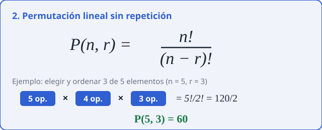
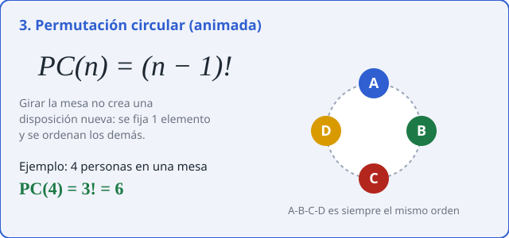
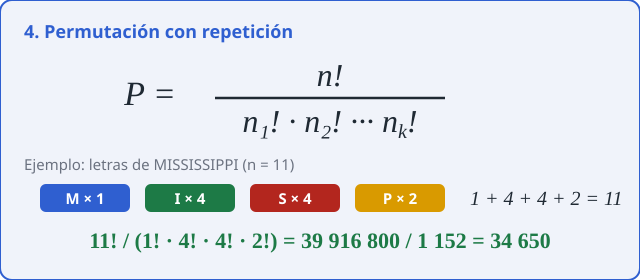
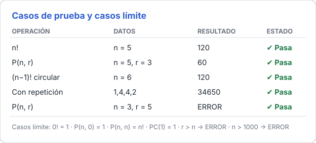

# Permutaciones

Calculadora web para permutaciones **lineales**, **circulares** y **con repetición**, con resultado en tiempo real, fórmulas renderizadas con [KaTeX](https://katex.org/) y una tabla de casos de prueba editable.

## Estructura

```
├── index.html   # Estructura de la página
├── styles.css   # Estilos
├── script.js    # Lógica de cálculo, calculadora y pruebas
└── assets/      # Imágenes de este README
```

## Cómo usarlo

1. Abre `index.html` en el navegador (no requiere instalación; solo necesita internet para cargar KaTeX).
2. Elige la operación.
3. Escribe los datos: el resultado se actualiza solo.
4. Usa la tabla de **Casos de prueba** para comprobar resultados esperados.

## Operaciones

### 1. Permutación de n elementos


Cuántas formas hay de ordenar `n` elementos distintos. Ejemplo: `5! = 120`.

### 2. Permutación lineal sin repetición



Se toman `r` elementos de `n` y **importa el orden**. Ejemplo: `P(5,3) = 60`.
Si `r` se deja vacío, se asume `r = n`.

### 3. Permutación circular



Al sentar `n` elementos en círculo, girar la mesa no cuenta como un orden distinto. Ejemplo: `PC(6) = 5! = 120`.

### 4. Permutación con repetición



Hay elementos repetidos. Se escriben las repeticiones de cada elemento separadas por coma; el total `n` es su suma.
Ejemplo: **MISSISSIPPI** → `1,4,4,2` → `34650`.

## Casos de prueba



La tabla compara el resultado **esperado** con el **obtenido** y marca *Pasa* o *Falla*.

- Para un caso inválido, escribe `ERROR` como esperado.
- Con repetición, la columna «r o grupos» recibe los grupos (`1,4,4,2`).
- Puedes agregar (`Agregar caso`) o quitar (`X`) filas.

### Casos límite

| Caso | Resultado |
|------|-----------|
| `0!` | 1 |
| `P(n, 0)` | 1 |
| `P(n, n)` | `n!` |
| `PC(1)` | 1 |
| `PC(0)` | ERROR (requiere n ≥ 1) |
| `r > n` | ERROR |
| `n` no entero o negativo | ERROR |
| `n > 1000` | ERROR (límite de cálculo) |

## Notas técnicas

- Los cálculos usan `BigInt`, por lo que los factoriales grandes son exactos (sin pérdida de precisión).
- Si KaTeX no carga, las fórmulas se muestran como texto plano.
